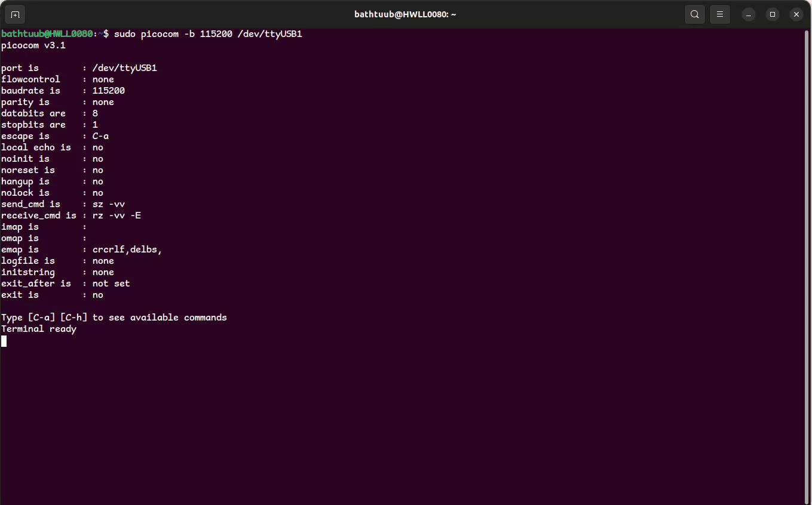
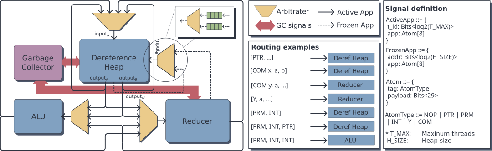

*I follow Lennart Augustsson's approach when he was presenting [MicroHs](https://github.com/augustss/MicroHs) --- give the demo first.*

*This is a Haskell program running on a specialised processor, which is hosted on an FPGA and talks through UART port:*



*There is no software runtime or "kernel trap" underneath, everything is handled by the hardware processor.*

*There is a more detailed [demo video](https://youtu.be/cafTcH-DuZM). If you want to reproduce this demo, either by running it on your FPGA or using our simulator, see the [guidance](#guidance).*

## Introduction

My PhD study topic is about specialised hardware design for non-strict functional languages. This post talks about my recent work on adding IO capability into our Haskell processor and putting it on an FPGA, with a goal of convincing people that a Haskell processor is a cute idea.

Specialised hardware for functional languages actually has a lot of interesting [histrory](https://haflang.github.io/history.html#event-functional-hardwarebr-1924-2024), especially in the 80s. This idea was  largely abandoned during the 90s, because of better software implementation and the evolving speed of standard CPUs at the time. 

For reasons well known, specialised hardware is becoming interesting again. We try to investigate the possibility of this old idea in today's context. I will present the hardware architecture, IO handling, FPGA implementation results, and some limitation of this work.


## Architecture Overview

Our processor is called **Ouros**, a combinator-based graph reduction machine. Many design details, including representation of combinators, thread management (Ouros can do automatic multi-threading!) and garbage collection, can be found in our paper[^1]. The figure below is an overview of the processor architecture.



Unlike a conventional processor, Ouros does not execute a sequence of instructions. Instead, a Haskell program is compiled into *combinator graphs*, and execution is a process of repeatedly reducing function applications. Each application (we call it an *App*) is represented by a fixed-size word containing a function and its arguments. Larger expressions are stored in the heap as multiple Apps connected by pointers.

The main components are the **Dereference Heap**, which follows pointers and manages threads; the **Reducer**, which performs combinator reduction; and the **ALU**, which handles arithmetic. Apps move between these components as data tokens, and each component processes them whenever its input is ready. This is why we call Ouros *dataflow-driven*, rather than instruction-driven. Ouros also supports relatively large combinators, which can save quite a few reduction steps. Readers interested in the combinators and how we compile Haskell into them can refer to our earlier paper[^2] on structured combinators and our [MicroHs fork](https://github.com/bathtub-01/MicroHs).

Another interesting feature is automatic fine-grained multi-threading. For example, when an arithmetic operation needs two independent values, Ouros can evaluate them in separate threads without any explicit threading code in the Haskell program. These threads share the same hardware pipeline. There is also a concurrent hardware garbage collector, which reclaims unused heap cells alongside normal execution.


## Handling IO in Ouros

Adding IO allows the Ouros processor to become a standalone computer, rather than just a machine for evaluating pure expressions. The question is how to introduce side effects without hurting the graph reduction model.

We use the familiar state-passing representation of the `IO` monad[^3]:

```haskell
type World = Int
newtype IO a = IO (World -> (a, World))

runIO :: IO a -> World -> (a, World)
runIO (IO f) = f

instance Monad IO where
  return a = IO (\w -> (a, w))

  (IO m) >>= k = IO (\w ->
    case m w of
      (a, w') -> runIO (k a) w')
```

Here `World` is just a dummy `Int`, not a representation of the actual world. The important part is the dependency: each IO operation consumes a World token and produces one for the next operation. This gives the operations an order, even though the processor evaluates Haskell lazily.

The low-level primitive IO interface is intentionally kept simple:

```haskell
writeAXIReg :: Int -> Int -> IO ()
writeAXIReg = primitive "IO.Write"

readAXIReg :: Int -> IO Int
readAXIReg = primitive "IO.Read"
```

They allow a Haskell program to read and write a set of registers. The compiler turns these primitives into special IO operations understood by the hardware. When an IO operation is ready, a dedicated IO unit performs the corresponding **AXI4-Lite** transaction, and the result goes back into the normal graph reduction pipeline. The operation only finishes after the bus transaction completes.

The AXI4-Lite details are hidden from the Haskell program. From programmer's point of view, it is simply reading and writing registers, some of which are connected to the outside world. This is how we get actual side effects without a software runtime.

Currently the FPGA demo only uses a UART, with the Haskell program polling its registers. The same interface could also be connected to GPIOs, timers, a hardware random number generator, etc.

## Some FPGA Implementation Results

The FPGA board I am using is [AUP-ZU3](https://www.realdigital.org/hardware/aup-zu3), which was kindly donated by people from AMD.

The current design runs at **100 MHz** on this board. Its resource usage is approximately **27% of LUTs, 7% of registers and 40% of BRAM**. The BRAM usage is mainly determined by the heap and code memories, so it can be adjusted by changing their sizes.

What I find quite encouraging is that the logic footprint is roughly in the range of a small pipelined RISC-V core. Of course, this is not a like-for-like comparison, and Ouros has many limitations (some are listed below). Still, it is nice to see that we can have direct hardware support for graph reduction, automatic threading and garbage collection within a fairly small circuit budget. 

## Limitations and Discussion

- **Limited primitives:** Currently Ouros doesn't support `Float` or `Double`; its ALU also doesn't support division on `Int` yet. It wouldn't be very hard to add `Float` and more arithmetic operations, but `Double` can be harder due to encoding.
- **Missing Haskell features:** I am totally relying on the MicroHs frontend to handle Haskell source, and haven't done any serious tests to check what language features are missing --- my experience suggests that basic stuffs like ADT, list comprehension and type class do work well (but I am not a decent Haskell programmer).
- **No memory hierarchy:** A heap memory of 8K×288-bit words and a code memory of 4K×288-bit words seems to fit on the AUP-ZU3 board. A Haskell program with 1-2k lines can likely be hosted in the code memory --- but a more serious deisgn to utilise the big off-chip memories for programs with bigger heap footprint and code size might need considerable engineering effort to build.
- **No dynamic program loading:** Currently a Haskell program needs to be pre-compiled with Chisel to generate memory initialisation files for the memory. Dynamic loading can possibly be achieved by adding some state machines for reset and injection.
- **No interrupt in hardware:** We only have poll-based IO; how to properly add interrupt to the system can be an interesting question, but currently I don't have an answer to it.

An immediate question someone might ask is: *how does this machine compare to a PC running GHC-compiled code?* This is not easy to answer. If we only care about wall-clock speed, the FPGA demo is likely to be several times slower than a modern laptop. However, the implementation technology, circuit size, and power consumption model are all very different, making a fair comparison difficult. Also, since Ouros has a rather unusual memory organisation, we cannot simply assume that its performance would improve by several times if implemented as an ASIC using a 7nm process.

Apart from being a cute toy, does this FPGA demo show any practical value? One possibility I can imagine is something like a Raspberry Pi, but with Haskell as its bare-metal programming language. Being able to run Haskell directly on a small embedded processor might be useful in certain scenarios. More interestingly, I think a native Haskell processor could open up some research possibilities that have been difficult to explore in practice. For example, what would a small operating system written entirely in Haskell look like?

## Guidance on Reproducing the Demo {#guidance}

There are several related repo for Ouros:
- A fork on MicroHs:  https://github.com/bathtub-01/MicroHs (go to branch `real-world`).
- Hardware implementation of Ouros: https://github.com/bathtub-01/ouros-chisel (go to branch `real-world`).
- A cycle-accurate simulator of Ouros: https://github.com/bathtub-01/ouros-simulator (go to branch `real-world`).

## Reference
[^1]: Xie, Yukang, Craig Ramsay, Robert Stewart, and Hans-Wolfgang Loidl. "Ouros: A Dataflow-Driven Processor for Lazy Functional Programming Languages." In 2026 IEEE 37th International Conference on Application-specific Systems, Architectures and Processors (ASAP), pp. 85-92. IEEE, 2026. doi: [10.1109/ASAP71856.2026.00023](https://doi.org/10.1109/ASAP71856.2026.00023).
[^2]: Xie, Yukang, Craig Ramsay, Robert Stewart, and Hans-Wolfgang Loidl. "From Haskell to a new structured combinator processor." In International Symposium on Trends in Functional Programming, pp. 139-164. Cham: Springer Nature Switzerland, 2025. doi: [10.1007/978-3-031-99751-8_7](https://doi.org/10.1007/978-3-031-99751-8_7).
[^3]: Peyton Jones, Simon L., and Philip Wadler. "Imperative functional programming." In Proceedings of the 20th ACM SIGPLAN-SIGACT symposium on Principles of programming languages, pp. 71-84. 1993. doi: [10.1145/158511.158524](https://doi.org/10.1145/158511.158524).